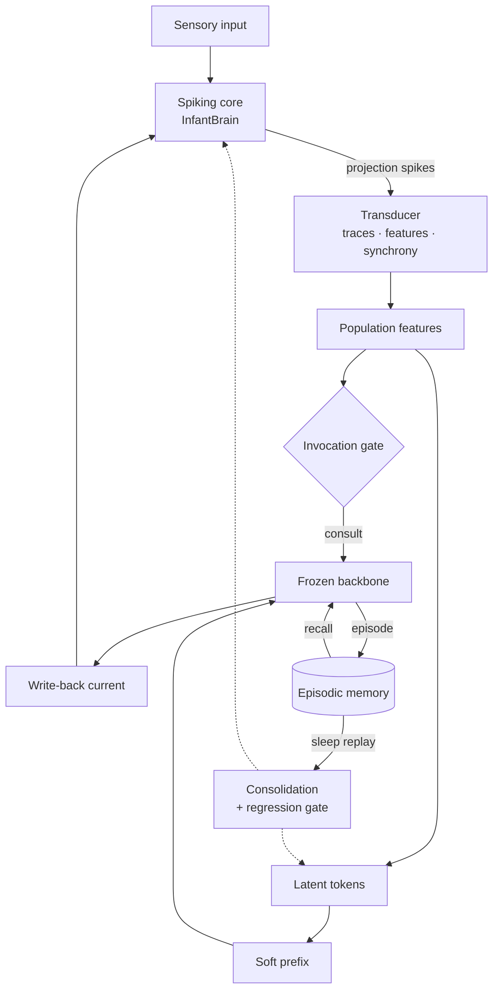

# Continuous Brain

A persistent agent built from three parts:

- a **spiking executive core** that runs continuously and carries the individual's continuity,
- a **frozen pretrained transformer** the core consults when it needs language or reasoning,
- **episodic memory and sleep-phase consolidation**: the only times anything learns, and every change passes a regression gate.

Design reference: *Continuous Brain — Hybrid Architecture Spec v0.1* (the living spec doc). This repo implements its Phases 0–3 infrastructure.

## Status

| Piece | State |
| --- | --- |
| State preservation (snapshots, checksums, never-overwrite, rollback) | Built, tested |
| Spike→token transducer (events, multiscale traces, features, synchrony, pooling, latent tokens) | Built, tested |
| Bridge: soft-prefix read path, write-back current decoder, invocation gate | Built, tested |
| Frozen backbone adapter (Hugging Face, 4-bit) | Built; tested on a locally built tiny Qwen2, **not yet on a real checkpoint** |
| Episodic memory (append-only, salience, recall) | Built, tested |
| Sleep consolidation with per-component regression gate | Built, tested |
| Waking loop | Built, tested end to end |
| **InfantBrain / CorticalNucleus v0.11.3** | **Not in this repo yet.** See [Porting InfantBrain](#porting-infantbrain) |

`ReferenceLIFCore` is a stand-in spiking core (LIF + sparse Dale's-law recurrence + reward-modulated STDP) so everything around InfantBrain can be built and tested now. **It is not InfantBrain.** Nothing trained on it is project history.

## Architecture



| Module | What it does |
| --- | --- |
| `state/snapshot.py` | Timestamped, SHA-256-checksummed, read-only snapshots; atomic directory claim; COMPLETE marker; append-only version log; restore only into new directories. `scripts/snapshot.sh` is the shell equivalent. |
| `core/interface.py` | `SpikingCore`: the contract InfantBrain implements. |
| `transducer/` | Sparse `(batch, neuron, time)` events → multiscale leaky traces (5 ms–2 s) integrated in parallel with a decay kernel → per-neuron features `[X, ΔX, Δ²X, recency, burst]` → population mean-pooling + Golomb–Rinzel synchrony χ² → K latent tokens via Perceiver/Q-Former cross-attention, with an amplitude/direction split so activity level survives normalization. |
| `bridge/prefix.py` | Latent tokens → soft-prompt prefix at the backbone's embedding scale (BLIP-2 pattern; no layers spliced into the frozen model). |
| `bridge/writeback.py` | Backbone hidden state → bounded current on the core's input neurons (Gaussian policy). |
| `bridge/gate.py` | Consult iff trigger-population activity > θ and past the refractory period, or a message arrives. |
| `bridge/backbone.py` | `Backbone` interface + `HFBackbone` (frozen, optional 4-bit, gradient checkpointing). |
| `memory/episodic.py` | Append-only episode log + atomic array files; salience = outcome + novelty + explicit flag; cosine recall. |
| `sleep/` | Consolidation cycle and regression probes. |
| `agent/loop.py` | `ContinuousBrain`: the waking loop, feedback, sleep, checkpoints. |

### What learns, how, and when

Nothing learns while awake. During `sleep()`:

| Component | Rule | Signal |
| --- | --- | --- |
| Latent pool + prefix | Backprop *through* the frozen backbone | NLL of the episode's target given its stored features and prompt, salience-weighted |
| Write-back decoder | REINFORCE with baseline | Episode outcome |
| Spiking core | Its own local plasticity only (never in the backprop graph) | Replayed inputs + neuromodulator `m = outcome − mean outcome` |
| Backbone | Never trains | — |

This resolves the spec's open question the way it assumed: backprop for the bridge, local rules only for the core. The boundary is structural, since spikes are read after the fact and never enter the gradient graph.

### The regression gate

Each sleep is bracketed by identical probe runs (same inputs, same noise seeds):

- `general_language` (guards the bridge): does the prefix make the backbone worse at generic text?
- `core_health` (guards the core): is spontaneous firing still inside a healthy band?
- `matched_pair_discrimination` (guards the core): d′ between the core's responses to mirror-image input pairs, over independent noise seeds. This probe targets the core's **own** weights.
- `episode_recall`: reported, not guarded.

A component whose guarded probe regresses is restored exactly from the pre-sleep snapshot; the other keeps its update. Episodes are marked consolidated only when every component accepted.

First end-to-end run, for the record: on the reference core, the R-STDP replay **lowered** matched-pair discrimination (d′ 0.77 → 0.70). The gate rolled the core back and kept the bridge's improvement. That's the stand-in core, not evidence about InfantBrain, but it's the risk the spec flagged: local plasticity is the unproven bet, and the gate is what keeps it honest.

## Quickstart

```bash
pip install -e ".[dev]"            # torch, numpy, pytest
python -m pytest                   # 58 tests, CPU, ~15 s
```

Minimal run with the stand-in core and the test backbone:

```python
import torch
from continuous_brain.agent import ContinuousBrain
from continuous_brain.core import ReferenceLIFCore
from continuous_brain.testing import TinyBackbone

brain = ContinuousBrain(ReferenceLIFCore(), TinyBackbone(), root="runs/dev")
brain.run(100, sensory=torch.full((64,), 0.8))        # 2 s of continuous core activity
r = brain.tick(message="What is my name?")            # forces a consultation
brain.feedback(r.episode_id, outcome=1.0, target=" David.")
report = brain.sleep()                                # consolidate, gated
print(report.accepted_components, report.rolled_back_components)
```

With the real backbone (GPU, `pip install -e ".[backbone]"`):

```python
from continuous_brain.bridge import HFBackbone
# Set this to the exact Hugging Face repo id after confirming the current
# ~27B Apache-2.0 checkpoint (spec: "Frozen backbone"). Not hard-coded here
# because open-weight releases change monthly.
MODEL_ID = ...
backbone = HFBackbone.from_pretrained(MODEL_ID, load_in_4bit=True)
```

VRAM budget on a 24 GB card: ~13.5 GB for a 27B backbone in 4-bit, a bridge of order 10⁷ parameters, and the rest for KV cache and backward activations (gradient checkpointing is on).

## Porting InfantBrain

InfantBrain v0.11.3 and its 14,000-update checkpoint are on the home machine. From there:

1. **Snapshot first**: `scripts/snapshot.sh <checkpoint> pre-port`.
2. Copy the v0.11.3 source into `continuous_brain/core/infantbrain/` unchanged.
3. Implement `core/infantbrain_adapter.py` against `SpikingCore` (the steps are in that file). Map its stream/region labels to `projection_regions()` so populations follow its real anatomy.
4. Wire its working-memory input (fed zeros to date) to real input neurons.
5. Add the adapter to `CORE_FACTORIES` in `tests/test_core_contract.py` and make that file pass.
6. Replace `MatchedPairProbe`'s default pairs with the real varied task family (matched left/right pairs).

## State rules

- `runs/`, checkpoints, episodes, and logs are git-ignored and never committed.
- Snapshots are never overwritten; restores go into new directories.
- Sleep refuses to start if its pre-sleep snapshot fails verification.
